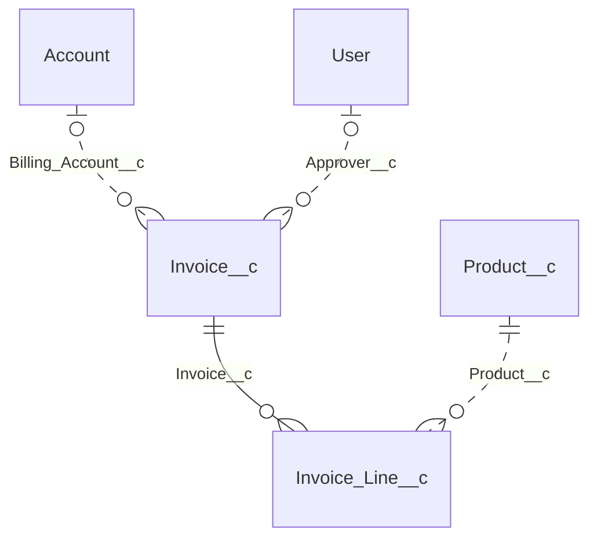

# 0056 — `simply document erd`: Mermaid ERDs of a project's data model

**Status:** Accepted — core implemented (simply-document-core 0.3.0); CLI pending
**Package:** `packages/simply-document-core` (library); `packages/simply-document` (CLI, in
`simply-plugins`, where this doc is duplicated as its 0057)
**Date:** 2026-10-29

## Problem

`simply document generate` renders a technical design document whose data model section is one
field table per object. That's the right reference for "what's on `Invoice__c`?", but it can't answer
"how do these objects relate?". A reader has to scan every `Lookup(...)`/`MasterDetail(...)` cell
across dozens of tables and assemble the graph in their head. Teams draw that picture by hand in
Gliffy instead, and the hand-drawn diagram is out of date the first time someone adds a lookup.

A diagram that lists every field doesn't fix this. A project with 40 objects and 600 fields produces
boxes nobody can read. The useful picture is objects and the relationships between them, and nothing
else.

## Decision

Add a new command, `sf simply document erd`, that scans a project the same way `generate` does and
writes a Markdown file of one or more Mermaid `erDiagram` blocks. Nodes are objects only, with no
field attributes. Edges are Lookup, Master-Detail, and Hierarchy fields, labelled with the field's
API name. Above a size threshold, the model is split into one diagram per connected cluster of
objects, so each diagram stays readable.

The intended workflow is copy and paste. In Confluence, insert a Gliffy diagram, choose **Create from
code → Mermaid**, paste one block, and convert. Gliffy for Confluence lists entity relationship
diagrams among its supported Mermaid types (see
[Gliffy's Mermaid integration help](https://help.gliffy.com/confluence/Content/GliffyConfluence/Mermaid-integration-confluence.htm)).
The same Markdown file also renders as-is on GitHub, GitLab, and in VS Code's preview.

The graph building, clustering, and Mermaid rendering go in `simply-document-core` as pure
functions, next to `buildTechnicalDesignDocumentHtml`. This follows [0020](0020-simply-document-core.md)'s reasoning: a caller that
has already scanned a project another way (a CI job, an editor extension, the planned MCP server)
should get the same diagrams without the CLI. The plugin keeps only scanning, flags, and file
writing. To share scanning with `generate`, it's pulled out of `generate.ts`'s `run()` into a
common module, with no change to `generate`'s behavior.

The technical design document itself does not change in this doc. See
[Open questions](#open-questions).

## Behavior

```
sf simply document erd --directory force-app --output-file erd.md
sf simply document erd --directory force-app --output-file erd.md --max-objects 25 --hub User --hub Account
```

| Flag            | Notes                                                                                                                                                                      |
| --------------- | -------------------------------------------------------------------------------------------------------------------------------------------------------------------------- |
| `--directory`   | Required. Same meaning as `generate --directory`: the Salesforce DX source directory to scan.                                                                              |
| `--output-file` | Required. The Markdown file to write. Overwritten if it exists, like `generate --output-file`.                                                                             |
| `--max-objects` | Integer, default `40`, minimum `2`. If the whole model has this many objects or fewer, one diagram is written. Above it, the model is split (see [Splitting](#splitting)). |
| `--hub`         | Repeatable, default `User`. Objects that don't join clusters together when splitting (see [Hub objects](#hub-objects)). Giving the flag replaces the default.              |

### What's in the diagram

**Objects.** Every object in the scan's `standardObjects` and `customObjects`. Custom settings,
custom metadata types, and platform events are left out: they can't be the target of a Lookup or
Master-Detail field, and including them would only add boxes with no edges.

**Relationships.** One edge per field whose raw metadata `type` is one of:

| Field type             | Edge (parent on the left)               | Mermaid                              |
| ---------------------- | --------------------------------------- | ------------------------------------ |
| `MasterDetail`         | Parent one, child many, identifying     | `Parent \|\|--o{ Child : "Field__c"` |
| `Lookup`, required     | Parent one, child many, non-identifying | `Parent \|\|..o{ Child : "Field__c"` |
| `Lookup`, not required | Parent zero or one, child many          | `Parent \|o..o{ Child : "Field__c"`  |
| `Hierarchy`            | Self-relationship on `User`             | `User \|o..o{ User : "Field__c"`     |

Solid lines (`--`) mean Master-Detail, where the child can't exist without the parent. Dotted lines
(`..`) mean Lookup. The parent is the field's `referenceTo`. For `Hierarchy` it's the object the field
is on. A field that's a Lookup or Master-Detail with no `referenceTo` is skipped and reported in
`skippedFields` (see [Output](#output)), not guessed at.

Two fields between the same pair of objects produce two edges, each with its own label. That's
intended: `Invoice__c.Billing_Account__c` and `Invoice__c.Shipping_Account__c` are different
relationships.

**External objects.** A `referenceTo` that names an object not in the scan (typically `Account`,
`User`, or a managed package's object) still gets a node, so the edge has somewhere to go. These are
listed under the diagram's heading in the Markdown as "Referenced, not in this project". They aren't
styled differently in the diagram, because Mermaid's ER styling support depends on the Mermaid version
and we don't know which version Gliffy embeds.

**Unrelated objects.** An object with no relationship in or out has nothing to show. It isn't
drawn, and it's listed once at the end of the file under "Objects with no relationships".

**Node names.** Nodes are the object's API name (`Invoice__c`, `ns__Thing__c`), not its label. API
names are always valid Mermaid ER identifiers. Labels can contain spaces and punctuation, and
Mermaid's `Name["Label"]` alias syntax may not be supported by the Mermaid version Gliffy uses.

**No attributes.** No fields appear inside the object boxes, not even the relationship fields. The
edge label already names the field, and empty boxes are what keep a 30-object diagram readable.

### Known gap: standard relationships

Standard fields in DX source (for example `Contact/fields/AccountId.field-meta.xml`) usually carry
no `type` or `referenceTo`, because Salesforce doesn't let you change them. So `Contact → Account`,
`Opportunity → Account`, and similar built-in relationships don't appear. Only custom relationship
fields do, including custom fields on standard objects. The command's description says so, so nobody
mistakes the diagram for a complete schema. A built-in table of common standard relationships is an
[open question](#open-questions).

### Splitting

If the connected model (excluding unrelated objects), counting in-project and external nodes, has `--max-objects` nodes or fewer, the file has
one diagram named after the project's directory. Otherwise:

1. Take the relationships and drop every edge that touches a hub object.
2. Find the connected components of what remains, treating edges as undirected. Each component with
   at least one edge becomes a diagram.
3. Add each hub back into every diagram that has an edge to it, along with those edges. A hub can
   appear in several diagrams. That's the point: `User` belongs in the picture wherever something
   looks it up, but it shouldn't merge every cluster into one.
   Hub-to-hub edges belong to no component. Add them to each diagram already containing either
   endpoint after the initial hub attachment, including the other endpoint if needed. This is a
   single pass against the initially attached nodes, so hub chains do not make placement depend on
   edge order. Objects connected only to hubs do not seed a diagram: if no non-hub edges remain,
   splitting returns no diagrams, even though these objects are not unrelated.
4. Name each diagram after its **anchor**: the in-project object with the most edges inside that
   diagram. Ties use ordinal string comparison (`a < b`), independent of locale.
5. Sort diagrams by in-project object count, largest first, then by anchor name.

Splitting is deterministic. The same source always produces the same file, so the output can be
committed and reviewed as a diff.

A component whose **in-project node count** is still larger than `--max-objects` after splitting is written as one diagram and
marked `oversized`. The command prints a warning naming it. Splitting it further (for example by
Master-Detail trees) means choosing which relationships to cut, and that's a judgment call this doc
leaves to the user. The initial threshold includes external nodes; oversized after splitting excludes
external nodes, while heading counts always include them. They can add a hub to break it apart. See [Open questions](#open-questions).

### Hub objects

A hub is an object that many unrelated objects look up to. `User` is the obvious one: an
`Approver__c` lookup on `Invoice__c` and a `Reviewer__c` lookup on `Case_Note__c` would otherwise
put invoices and case notes in the same cluster. `--hub` defaults to `User`. Projects with their own
hubs, usually `Account`, pass `--hub` once per object, which replaces the default (so
`--hub User --hub Account` keeps `User`). A `--hub` naming an object that isn't in the model is
ignored silently: it would be a hub with no edges either way.

Hubs only affect splitting. When the model fits in one diagram, `--hub` has no effect.

### Output

The Markdown file looks like this (shown split with `--max-objects 4`, to keep the example short):

````markdown
# Data model: force-app

Generated by `sf simply document erd`. Paste each block into Gliffy via Create from code → Mermaid.
Standard relationships (such as Contact → Account) aren't in DX source and aren't shown.

## 1. Invoice\_\_c (5 objects, 4 relationships)

Referenced, not in this project: Account, User



## 2. Case_Note\_\_c (2 objects, 1 relationship)

...

## Objects with no relationships

Audit_Log\_\_c, Feature_Flag\_\_c
````

Within a diagram, edges are sorted by parent API name, then child, then field. That keeps the output
stable, and Mermaid lays out the graph itself regardless of the order.

Human output: a table with columns `#`, `DIAGRAM`, `OBJECTS`, `RELATIONSHIPS`, then
`Wrote N diagram(s) to <file>.` Warnings come after:

- `<anchor> has N objects, more than --max-objects (M). Add a --hub to split it further.`
- `Skipped N relationship field(s) with no referenceTo: Obj__c.Field__c, ...`

`--json`:

```json
{
  "outputFile": "erd.md",
  "diagrams": [
    { "name": "Invoice__c", "objectCount": 5, "relationshipCount": 4, "oversized": false },
    { "name": "Case_Note__c", "objectCount": 2, "relationshipCount": 1, "oversized": false }
  ],
  "objectCount": 8,
  "relationshipCount": 5,
  "externalObjects": ["Account", "User"],
  "unrelatedObjects": ["Audit_Log__c", "Feature_Flag__c"],
  "skippedFields": []
}
```

### Errors

- A scan failure uses the same `error.scanFailed` message and behavior as `generate`.
- An empty project, or one with objects but no relationships, is not an error. The file is written
  with no diagrams and only the "Objects with no relationships" list (or a "No objects found" line),
  and `diagrams` is `[]`.
- `--max-objects` below `2` is rejected by the flag's `min`.

### `simply-document-core` additions (minor release, `0.3.0`)

New module `src/entityRelationshipDiagram.ts`, re-exported from the root. All functions are pure and
deterministic.

| Export                                                                                                       | Purpose                                                                                                            |
| ------------------------------------------------------------------------------------------------------------ | ------------------------------------------------------------------------------------------------------------------ |
| `buildEntityRelationshipModel(objects)`                                                                      | `ObjectItem[]` → `EntityRelationshipModel`: nodes (in-project and external), edges, and `skippedFields`.           |
| `splitEntityRelationshipModel(model, options?)`                                                              | Applies [Splitting](#splitting). Returns `{ diagrams: ErdDiagram[]; unrelatedObjects: string[] }`.                 |
| `renderMermaidErDiagram(diagram)`                                                                            | One `ErdDiagram` → the `erDiagram` source text (no code fence).                                                    |
| `buildEntityRelationshipDiagramMarkdown(objects, options?)`                                                  | Convenience: all three above plus the Markdown wrapper. Returns `{ markdown, model, diagrams, unrelatedObjects }`. |
| `EntityRelationshipModel`, `ErdEntity`, `ErdRelationship`, `ErdRelationshipKind`, `ErdDiagram`, `ErdOptions` | Types for the above.                                                                                               |

```ts
export type ErdRelationshipKind = 'MasterDetail' | 'Lookup' | 'Hierarchy';
export type ErdEntity = { name: string; label?: string; external: boolean };
export type ErdRelationship = {
  parent: string;
  child: string;
  field: string;
  kind: ErdRelationshipKind;
  required: boolean;
};
export type EntityRelationshipModel = {
  entities: ErdEntity[];
  relationships: ErdRelationship[];
  skippedFields: string[]; // "Object__c.Field__c"
};
export type ErdDiagram = {
  name: string;
  entities: ErdEntity[];
  relationships: ErdRelationship[];
  oversized: boolean;
};
export type ErdOptions = { maxObjects?: number; hubs?: string[]; title?: string };
```

`CustomFieldItem` gains two optional fields. This is additive, so existing callers and custom TDD
templates are unaffected:

| Field          | Why                                                                                                                                                                            |
| -------------- | ------------------------------------------------------------------------------------------------------------------------------------------------------------------------------ |
| `referenceTo?` | `string \| string[]`. The scanner already passes it through at runtime (`massageCustomField` spreads the raw XML), but the exported type never declared it.                    |
| `fieldType?`   | The raw metadata `type` (`Lookup`, `MasterDetail`, ...). `type` holds the display string (`Lookup(Account)`), and parsing that back would tie the ERD to the TDD's formatting. |

`buildEntityRelationshipModel` reads `fieldType ?? type` and matches it exactly, so a caller who
passes unmassaged field data (raw `type: 'Lookup'`) gets the same result without setting `fieldType`.
A `referenceTo` array (not possible for custom fields today, but allowed by the XML shape) produces
one edge per target.

## Alternatives considered

- **Embed the diagram in the TDD as a Mermaid macro.** This was the first idea. Confluence has no
  built-in Mermaid rendering: it needs a Marketplace app, each app uses a different macro name, and a
  page without the app shows a broken macro. We also want Gliffy, so the diagram can be edited and
  laid out by hand after import. Gliffy imports Mermaid through its editor, not through a storage-format
  macro. Rejected for now. It could come back as an option once a team has picked an app (see
  [Open questions](#open-questions)).
- **Generate a `.gliffy` file directly.** Gliffy's JSON format has no published schema. We'd be
  reverse-engineering it from sample files, laying the diagram out ourselves (Mermaid does that for
  free), and attaching it to a page through the Confluence REST API with Gliffy-specific attachment
  comments. That's a lot of fragile surface to avoid one paste. Rejected.
- **Pre-render to SVG or PNG with `mermaid-cli`.** That needs Puppeteer and a headless Chromium in a
  package whose only dependency today is `handlebars`. The image also can't be edited in Gliffy.
  Rejected.
- **A `--erd` flag on `generate` instead of a new command.** `generate` writes one Confluence HTML file
  and its `--output-format` is reserved for alternative renderings of that same document. An ERD is a
  different artifact with a different format and different flags (`--max-objects`, `--hub`). Folding
  it in would mean two output files from one command. Rejected.
- **Show relationship fields (or external IDs) inside the boxes.** This duplicates the edge labels and
  is the first step back toward the unreadable everything-diagram. The TDD's field tables already have
  the details. Rejected.
- **One diagram always, and let Gliffy cope.** Mermaid's ER layout becomes a tangle well before 50
  nodes, and Gliffy's conversion preserves the tangle. Rejected in favor of splitting above a threshold.
- **Split by connected component without hubs.** In practice almost every org has custom lookups to
  `User`, so the whole model becomes one component and splitting does nothing. Rejected.
- **Detect hubs automatically (for example, anything referenced by 8+ objects).** This is plausible,
  but the output would then change in surprising ways as the project grows: one more lookup to
  `Account` would suddenly reshape every diagram. An explicit `--hub` list with a `User` default is
  predictable. Left as an open question rather than rejected outright.
- **Put the graph code in the plugin.** That would follow `generate`'s scanning, but it would leave the
  MCP server and any other non-CLI consumer to reimplement the clustering. Same reasoning as 0020.
  Rejected.

## Implementation plan

`simply-plugins-core` first (release `simply-document-core@0.3.0`), then `simply-plugins`.

### `simply-plugins-core`

1. `packages/simply-document-core/src/technicalDesignDocumentTemplate.ts`: add `referenceTo?` and
   `fieldType?` to `CustomFieldItem`, with JSDoc. No template change.
2. `packages/simply-document-core/src/entityRelationshipDiagram.ts` (new):
   - `buildEntityRelationshipModel`: iterate objects, then fields. Use a `Set` of in-project names to
     decide whether each parent is `external`. Collect `skippedFields`. Sort entities by name.
   - `splitEntityRelationshipModel`: if node count ≤ `maxObjects` (default 40), return one diagram.
     Otherwise run a union-find over non-hub edges, re-attach hubs, then choose anchors and sort as in
     [Splitting](#splitting). `unrelatedObjects` is in-project entities with no edges.
   - `renderMermaidErDiagram`: `erDiagram` header, then one line per relationship using the cardinality
     table. Indent two spaces, sort edges as described in [Output](#output), and always double-quote
     the label.
   - `buildEntityRelationshipDiagramMarkdown`: the wrapper text in [Output](#output). Escape `_` in
     headings and lists (Markdown would otherwise turn `__c` into bold), but not inside the fence.
3. `src/index.ts`: re-export the new functions and types.
4. `test/entityRelationshipDiagram.test.ts` (new). See [Testing](#testing).
5. `README.md` API table and `site/src/content/docs/guides/simply-document-core.md`: add an "Entity
   relationship diagrams" section with a short example.
6. Changeset/commit as `feat(simply-document-core): ...` so the release bumps the minor version.

### `simply-plugins`

1. Bump `@simplysf/simply-document-core` to `^0.3.0` in `packages/simply-document/package.json`.
2. `packages/simply-document/src/common/scanProject.ts` (new): move the component loop and object
   mapping from `generate.ts`'s `run()` (the `objectMap` pass, `massageCustomField`,
   `extractDescription`, and the raw XML types) into
   `scanProject(directory, onComponent?): Promise<TechnicalDesignDocumentData>`. The optional callback
   replaces the direct `this.spinner.status` writes. `massageCustomField` also sets
   `fieldType: customField.type` before it rewrites `type`. This is a refactor: `generate`'s output
   must be byte-identical before and after (pinned by a test, see below).
3. `generate.ts`: call `scanProject`. Keep its spinner messages and `componentCount` computation.
4. `src/commands/simply/document/erd.ts` (new): flags as in [Behavior](#behavior). Call
   `scanProject`, then `buildEntityRelationshipDiagramMarkdown([...standardObjects, ...customObjects],
{ maxObjects, hubs, title: path.basename(directory) })`. Write the file, print the table and
   warnings, and return the JSON shape.
5. `messages/simply.document.erd.md` (new): summary, a description that names the Gliffy workflow
   and the standard-relationships gap, flag summaries, examples, and the warning/info strings.
   `error.scanFailed` is duplicated from `simply.document.generate.md` rather than shared, matching how
   other packages keep one messages file per command (confirm against current convention).
6. `pnpm run build` in `packages/simply-document` and `packages/simply` to regenerate
   `command-snapshot.json`. Run `pnpm run readme` in both. Run `pnpm --filter site run sync`.
7. Changeset/commit as `feat(simply-document): add document erd`.

## Testing

### `simply-document-core` unit tests (`entityRelationshipDiagram.test.ts`)

| Case                                                       | Pins down                                                      |
| ---------------------------------------------------------- | -------------------------------------------------------------- |
| Master-Detail, required Lookup, optional Lookup, Hierarchy | Each renders the exact cardinality/line string from the table. |
| Lookup with no `referenceTo`                               | No edge; appears in `skippedFields` as `Obj__c.Field__c`.      |
| `fieldType` absent, raw `type: 'Lookup'`                   | Still produces an edge (external-caller path).                 |
| Massaged `type: 'Lookup(Account)'` with no `fieldType`     | Not treated as a relationship: no display-string parsing.      |
| Lookup to an object not in the input                       | Parent entity created with `external: true`.                   |
| Two fields between the same pair                           | Two edges, two labels.                                         |
| Object with no relationships                               | Not in any diagram; in `unrelatedObjects`.                     |
| Model at exactly `maxObjects` nodes                        | One diagram (the boundary is inclusive).                       |
| Two clusters joined only by `User`, above threshold        | Two diagrams, `User` in both, its edges in each.               |
| Same with `hubs: []`                                       | One diagram.                                                   |
| Component larger than `maxObjects` after splitting         | One diagram, `oversized: true`.                                |
| Anchor tie                                                 | Alphabetically first API name wins.                            |
| Input order shuffled                                       | Byte-identical Markdown (determinism).                         |
| `referenceTo` as an array of two                           | Two edges.                                                     |
| Headings with `__c`                                        | Escaped in headings and lists, unescaped inside the fence.     |
| Empty input                                                | "No objects found", `diagrams: []`.                            |

Also check that the rendered output of one fixture parses as Mermaid. Do this with `mermaid`'s
`parse()` as a **devDependency** in the test only, if it runs under vitest without a DOM (confirm).
Otherwise use a snapshot reviewed by hand once in mermaid.live.

### `simply-document` tests

- `test/common/scanProject.test.ts`: a small fixture project
  (`test/fixtures/erd-project/force-app/...`) with an `Invoice__c`/`Invoice_Line__c` Master-Detail, a
  Lookup to `Account`, a `User` lookup, and a custom setting. Asserts `fieldType` and `referenceTo`
  come through, and the custom setting lands in `customSettings`.
- `generate.test.ts`: add a case that runs `generate` against the same fixture and compares with a
  committed expected HTML file. This pins the refactor as behavior-preserving. Commit the expected file
  in the same PR, generated from `main` _before_ the refactor.
- `test/commands/simply/document/erd.test.ts`: missing required flags; empty directory (writes the
  file, `diagrams: []`); the fixture (JSON shape, file contents contain the expected `erDiagram`
  lines, the custom setting is absent); `--max-objects 2 --hub User` on the fixture produces an
  `oversized` warning or a split, whichever the fixture's shape implies (pick the fixture so it splits).
- No NUT is needed. The command never touches an org.

### Manual check before marking Implemented

Paste a generated block into Gliffy's Create from code → Mermaid on our Confluence, and record the
result in this doc: whether ER diagrams convert, whether quoted labels survive, and whether
`Name["Label"]` aliases work (which decides the first open question below).

## Open questions

- **Labels or API names on nodes?** API names are safe. Labels read better for non-developers. If the
  manual Gliffy check shows that aliases (`Invoice__c["Invoice"]`) work, add `--labels`. Decide after
  that check.
- **Standard relationships.** Should core ship a small built-in table of common standard relationships
  (`Contact.AccountId → Account`, `Opportunity.AccountId → Account`, `Case.ContactId → Contact`, ...),
  drawn only when both objects are in the project? It would make diagrams of standard-heavy projects
  far more useful, but it's a hand-maintained list that will always be incomplete. Leaning yes, as a
  follow-up doc.
- **Splitting oversized clusters further.** For example, by cutting non-required Lookups first and
  keeping Master-Detail trees intact. Wait until someone hits an `oversized` warning that `--hub` can't
  fix.
- **Automatic hub detection.** See the alternatives. Revisit if `--hub` turns out to be something
  every project has to tune.
- **External Lookup / Indirect Lookup (`__x` objects) and `MetadataRelationship` on custom metadata
  types.** Left out of this scope. Adding either later is additive (a new `ErdRelationshipKind`).
- **Big objects (`__b`).** The scanner currently files them under `standardObjects`, because it only
  checks for `__c`. They'd appear as ordinary nodes here. That's harmless, but the bucketing is
  arguably a separate bug in `scanProject`.
- **A TDD section.** Once a team has chosen a Confluence Mermaid app, `buildTechnicalDesignDocumentHtml`
  could embed the same diagrams in a "Data Model Overview" section using that app's macro name. That
  would be a separate doc, building on the functions here.
